# Lamino-Pal GUI 사용 설명서

스캔 폴더 가져오기부터 16-bit TIFF 내보내기까지, 한 mount group을 GUI로
처리하는 순서다. 캡처는 데모 프로젝트 `~/work/lamino_pal_demo`(raw root
`~/work/261003_Lamino_test`)에서 찍었다. 이 프로젝트에는 group
`mount_step`과 그 정렬값이 이미 있고, 여기에 `step800`을 새로 가져와 같은
group으로 재구성한다.

```
lamino-pal-gui --project ~/work/lamino_pal_demo/project.toml
```

`--project` 없이 띄우면 File ▸ Open project…로 `project.toml`을 고른다. GUI는
그 프로젝트의 GPU에 묶여 다시 실행된다.

## 0. 화면 구성

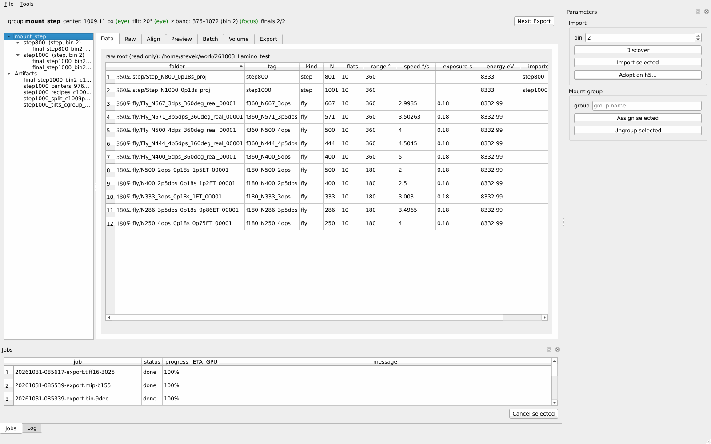

- **왼쪽 트리**: group ▸ scan(`step1000 (step, bin 2)`) ▸ 그 scan의 최종
  volume, 그리고 `Artifacts`(정렬·비교 결과 파일). 항목을 누르면 그 대상이
  현재 문맥(context)이 된다. volume은 Volume 탭에서, artifact는 그 파일을
  만든 작업의 탭에서 열린다.
- **상태 줄**(위): 현재 group과 결정값 `center`, `tilt`, `z band`. 괄호는 그
  값을 정한 방법이다. `(eye)`·`(focus)`·`(rings)`·`(user)`는 사람이 정한 것(초록),
  `(agent)`는 agent가 고른 것(주황), `undecided`는 미정(빨강)이다. agent가 고른
  값이 있으면 **Confirm agent decisions** 버튼이 나타난다. `finals n/m`은
  group의 scan 중 최종 volume이 있는 수이고, **Next: …** 버튼은 다음에 할
  탭으로 이동한다.
- **탭**: Data → Raw → Align → Preview → Batch → Volume → Export 순서로
  진행한다.
- **오른쪽 Parameters**: 현재 탭의 입력과 버튼. 이미지 viewer가 있는 탭에서는
  그 아래에 napari의 **layer controls**(선택한 레이어의 도구·contrast·색)와
  **layer list**(레이어 목록, 눈 아이콘으로 표시/숨김, 맨 아래 줄 오른쪽 집
  아이콘이 Reset view)가 붙는다. 이 오른쪽 열은 창 높이 전체를 쓰고, 각 칸은
  내용만큼 높이를 받으며 남는 높이는 layer list가 갖는다. 창이 낮아 모자라면
  칸 안에서 스크롤된다.
- **아래 Jobs / Log**: 탭 아래에 있다. GPU 작업의 진행률·남은 시간·GPU·메시지.
  작업을 고르고 **Cancel selected**로 취소한다. Log 탭은 실행한 op의 기록이다.

## 1. Data: 스캔 가져오기와 group 지정

1. Data 탭을 처음 열면 raw root(읽기 전용) 아래의 스캔 폴더를 자동으로
   찾는다(**Discover**와 같다). 표에는 폴더, tag, 종류(step/fly), 투영 수 N,
   flat 수, 회전 범위, 속도, 노출, 에너지, 이미 가져온 tag가 나온다.
2. 트리에서 group을 누르면 상태 줄에 그 group의 결정값이 나온다.

   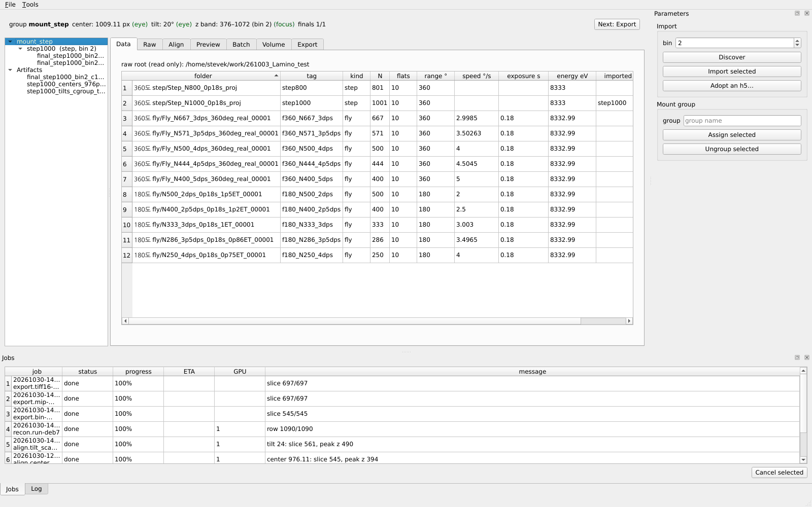

3. 가져올 폴더 행을 고른다(Ctrl/Shift로 여러 개). tag 칸은 더블클릭해 고칠
   수 있다. **bin**(기본 2)을 정하고 **Import selected**를 누르면 폴더마다
   `scan.import` 작업이 하나씩 돈다. Jobs에 `811/811 frames`처럼 진행이
   나오고, 끝나면 `imported` 칸에 tag가 들어간다.

   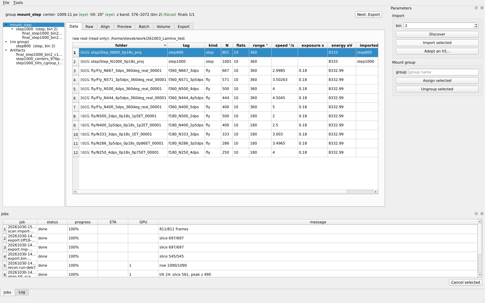

4. 가져온 행을 고르고 Mount group의 **group** 칸에 이름(`mount_step`)을 쓴 뒤
   **Assign selected**를 누른다. 트리에서 scan이 그 group 아래로 들어가고
   `finals`의 분모가 늘어난다(`1/2`). **Ungroup selected**는 group에서 뺀다.
   이미 만든 h5는 **Adopt an h5…**로 들인다.

   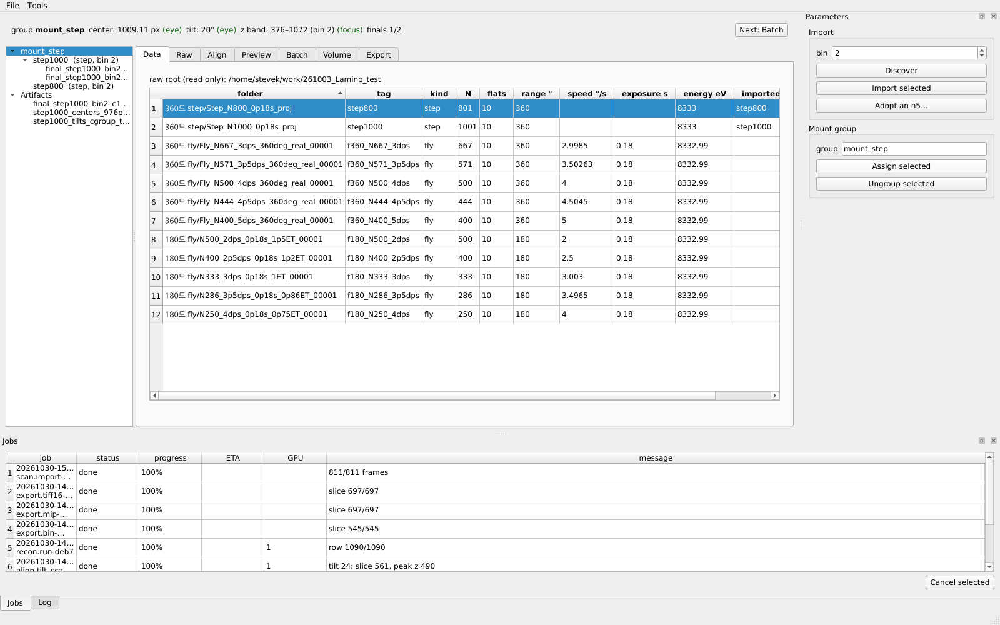

## 2. Raw: 원본 투영 확인

1. 트리에서 scan을 고르고 Raw 탭으로 간다. 슬라이더로 투영을 넘기며, 위
   글줄에 투영 번호와 각도, 한 바퀴의 투영 수·각도 범위·간격, 그리고
   "first + 360°"에 해당하는 투영 번호가 나온다.

   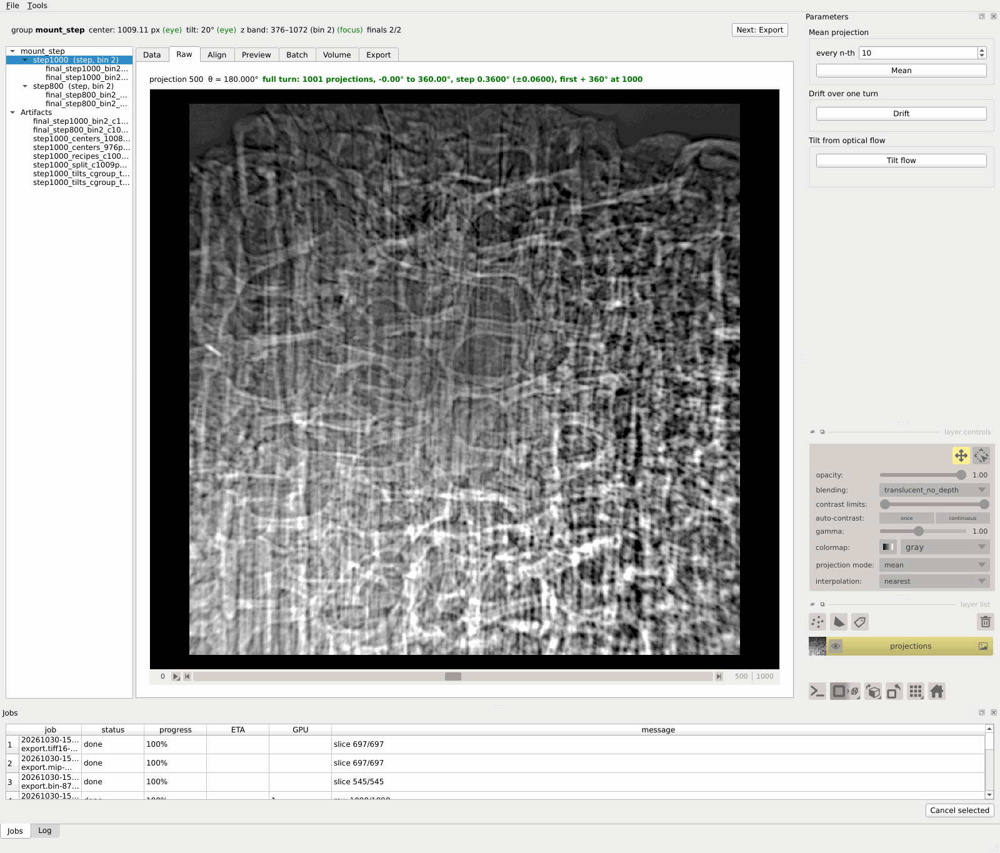

2. **Mean**(every n-th)은 n장마다의 평균 투영을 만든다.
3. **Drift**는 360° 뒤의 투영을 첫 투영과 비교한다. 첫 투영은 초록, 360° 뒤
   투영은 자홍으로 겹쳐지고, 아래 글에 어긋남이 나온다
   (`projection 1000 against 0: dy +0.4 px, dx -12.8 px`).

   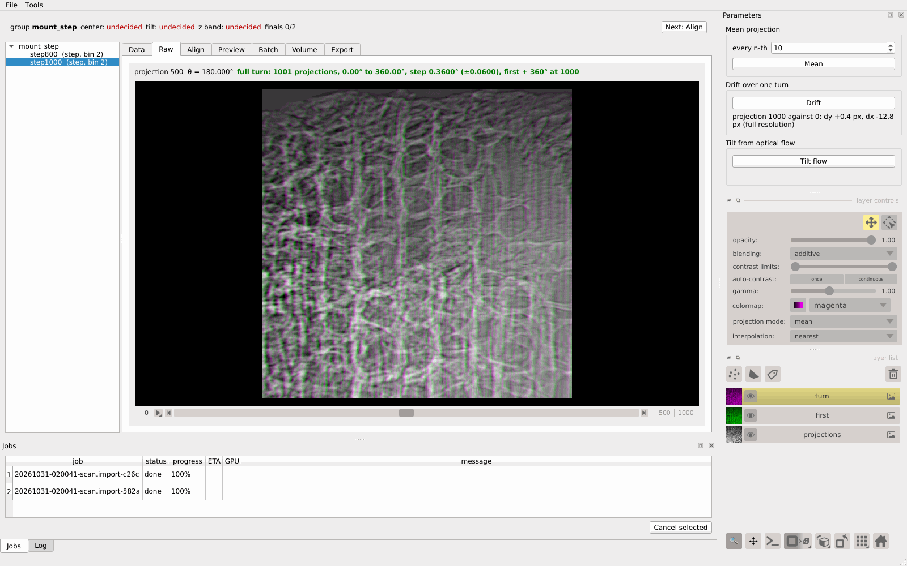

4. **Tilt flow**는 optical flow로 tilt를 어림한다. tilt scan의 교차 확인용이고
   결정값이 되지 않는다.

## 3. Align: 회전 중심과 tilt 결정

### 3.1 Rings

**every n-th**(10)와 **row bands**(4)를 정하고 **Rings**를 누른다. 투영의
링에서 중심을 어림해 `center 992.11 px, prominence 3.1`과 band별 값, 그
spread를 보여 준다. 이 값을 쓰려면 **Decide center (rings)**를 누른다.

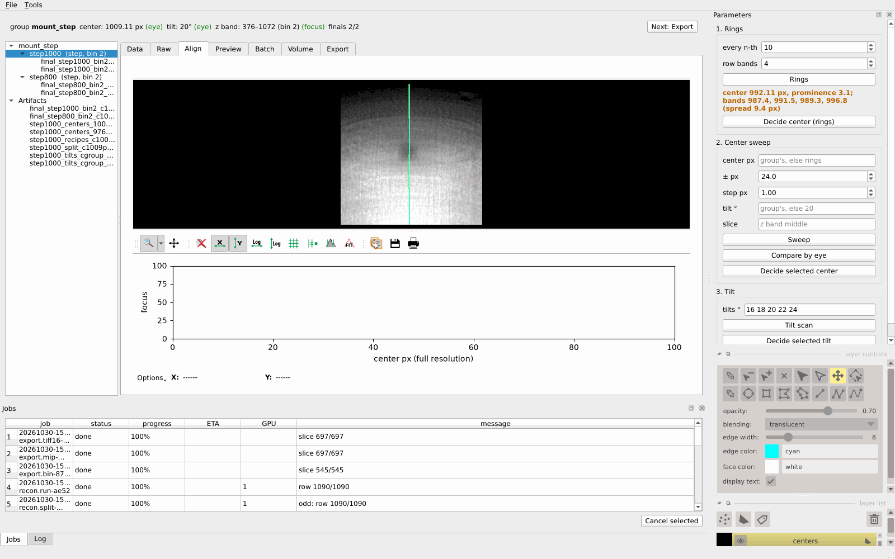

### 3.2 Center sweep

1. **center px**(비우면 group 값, 없으면 rings 값), **± px**, **step px**,
   **tilt °**(비우면 group 값, 없으면 20), **slice**(비우면 z band 가운데)를
   정하고 **Sweep**을 누른다. 실제로 쓴 값이 `resolved: center 1008.11 px on
   slice 724 at tilt 20°`처럼 나온다.
2. viewer에는 후보 중심마다의 slice가 쌓이고, 아래 그래프에는 중심별 focus
   값과 best(초록 선), 경쟁 후보(주황 선)가 나온다. 선의 이름은 그래프 제목에
   색으로 적힌다. 봉우리가 범위 끝에 걸리면 **범위 넓히기** 버튼이 나타나 두
   배 범위로 다시 sweep한다.

   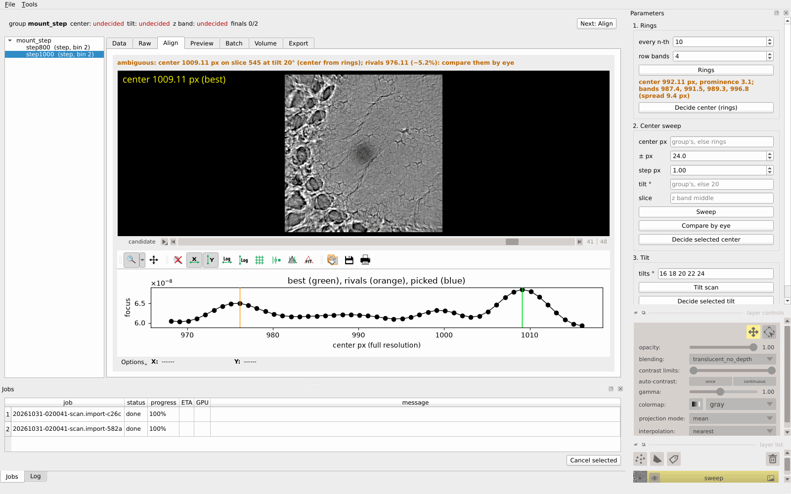

3. 후보는 슬라이더, 그래프 클릭 중 하나로 고른다. 고른 후보는 그래프에 파란
   선(picked)으로 나온다.

   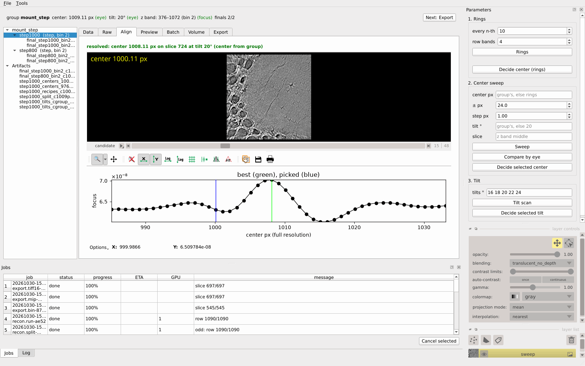

4. **Compare by eye**는 best와 그 경쟁 후보, 고른 후보를 각각 전체로 재구성해
   타일로 나란히 보여 준다(작업). 각 타일 안에 중심값이 붙는다. 타일이나
   그래프를 눌러 고르면 그 타일에 파란 테두리가 생긴다.

   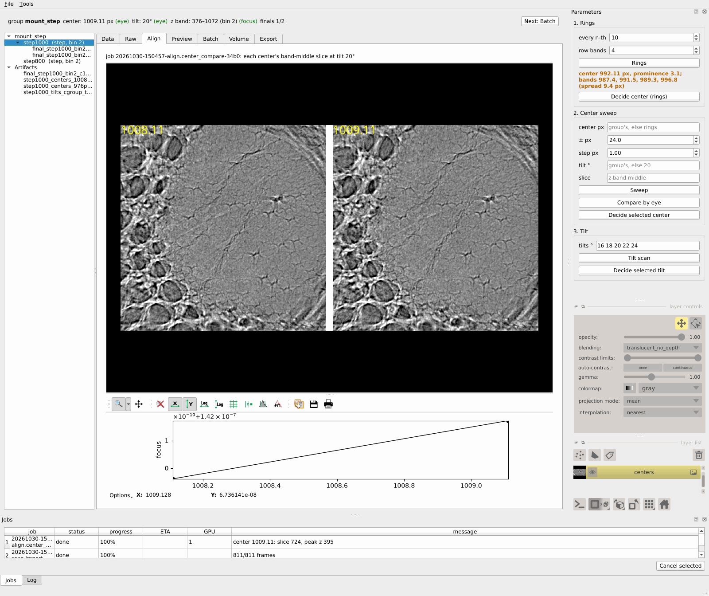

5. 고른 후보로 **Decide selected center**를 누르면 상태 줄의 center가 바뀌고
   `(eye)`가 붙는다.

### 3.3 Tilt

**tilts °**에 후보를 공백으로 쓰고(`16 18 20 22 24`) **Tilt scan**을 누른다. 위
줄은 tilt별 band 가운데 slice, 아래 줄은 같은 tilt의 xz 단면이며 각 타일에
tilt가 붙는다. 아래 그래프는 tilt별 focus다. 타일이나 그래프를 눌러 고르면
그 타일에 파란 테두리가 생긴다. **Decide selected tilt**를 누른다.

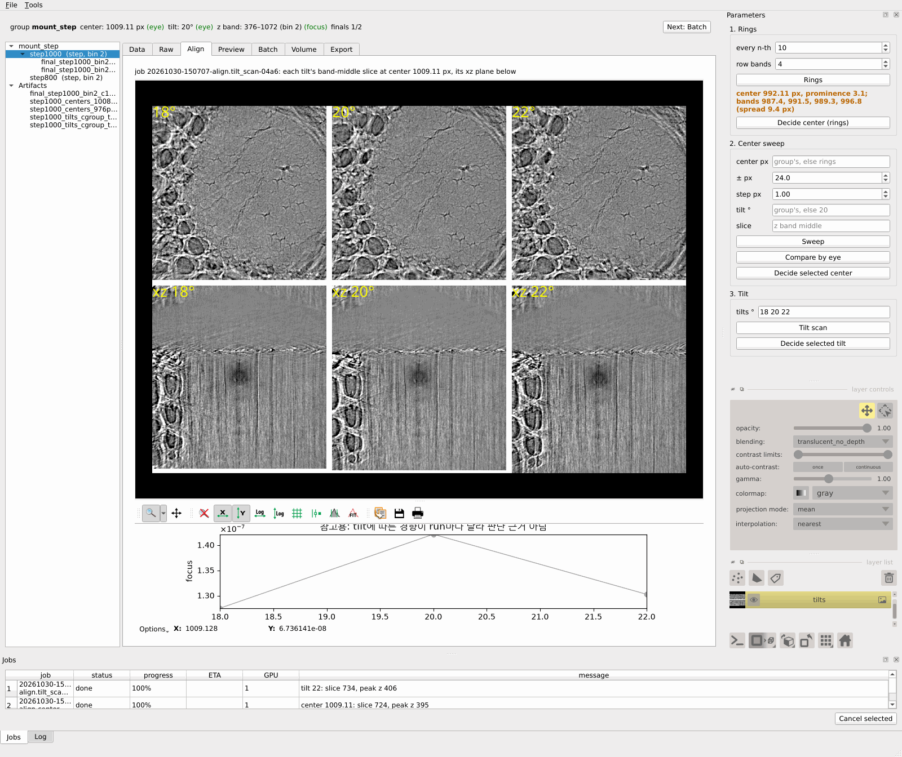

## 4. Preview: 레시피 확인과 품질 비교

1. Preview 탭을 열면 현재 문맥으로 미리보기가 돈다(지난번 뒤 입력이 바뀌었을
   때만). 위 글줄에 쓴
   중심·tilt·slice 위치·레시피가 나오고, z·y·x 세 단면이 격자로 나온다.

   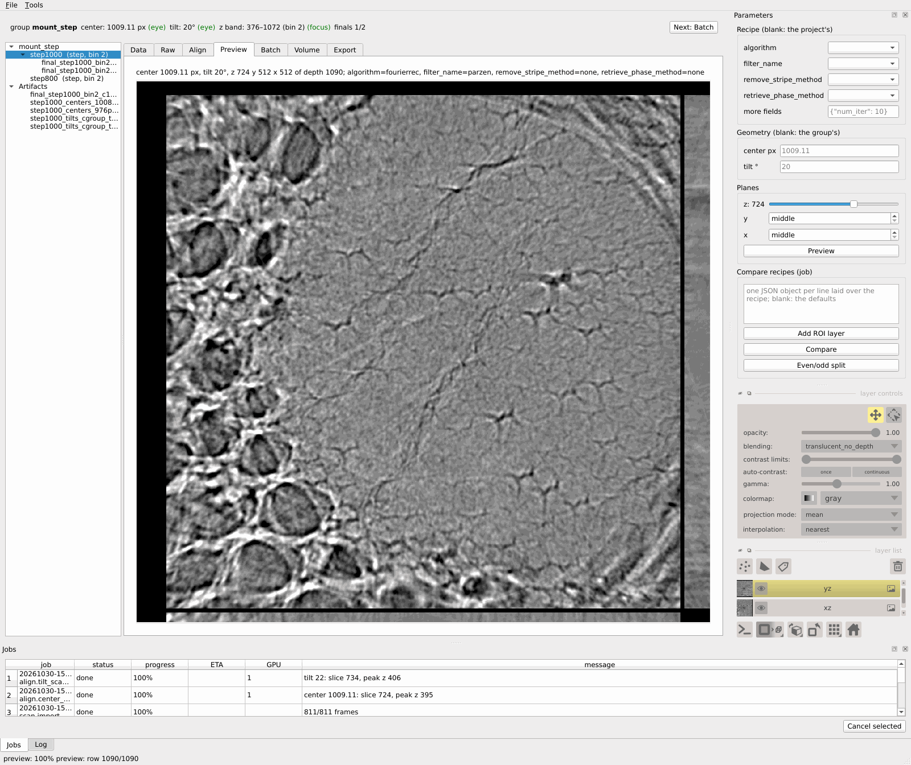

2. Parameters에서 **Recipe**(비우면 프로젝트 레시피: algorithm, filter_name,
   remove_stripe_method, retrieve_phase_method, more fields에 JSON),
   **Geometry**(비우면 group의 center px, tilt °), **Planes**(z 슬라이더, y,
   x)를 바꾸면 다시 계산한다. **Preview**는 입력이 같아도 다시 계산한다.
3. CNR을 재려면 **Add ROI layer**를 누른다. 아래 상태 막대에 "draw the signal
   rectangle first, the background second"가 나온다. layer controls의 사각형
   도구로 z 단면 위에 신호 영역을 먼저, 배경 영역을 그다음에 그린다.

   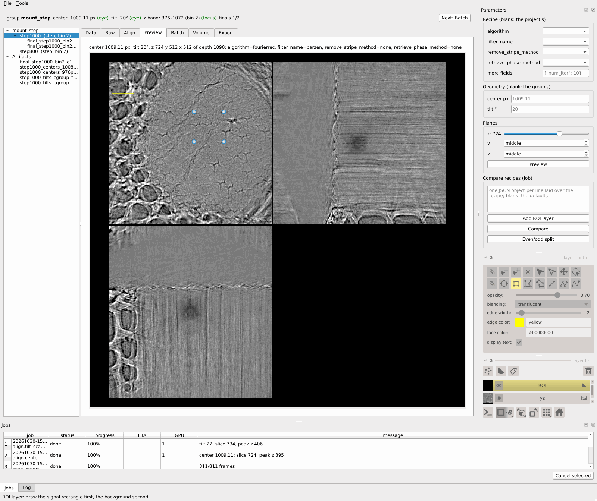

4. **Compare recipes** 칸에 레시피 변형을 한 줄에 JSON 객체 하나씩 쓴다
   (비우면 기본값들). 예:

   ```
   {"filter_name": "parzen"}
   {"filter_name": "shepp"}
   {"remove_stripe_method": "fw"}
   ```

   **Compare**를 누르면 작업으로 돈다.

   

5. 끝나면 변형마다 레이어가 생기고, 표에 variant, signal μ, background μ,
   background σ, CNR, window가 나온다.

   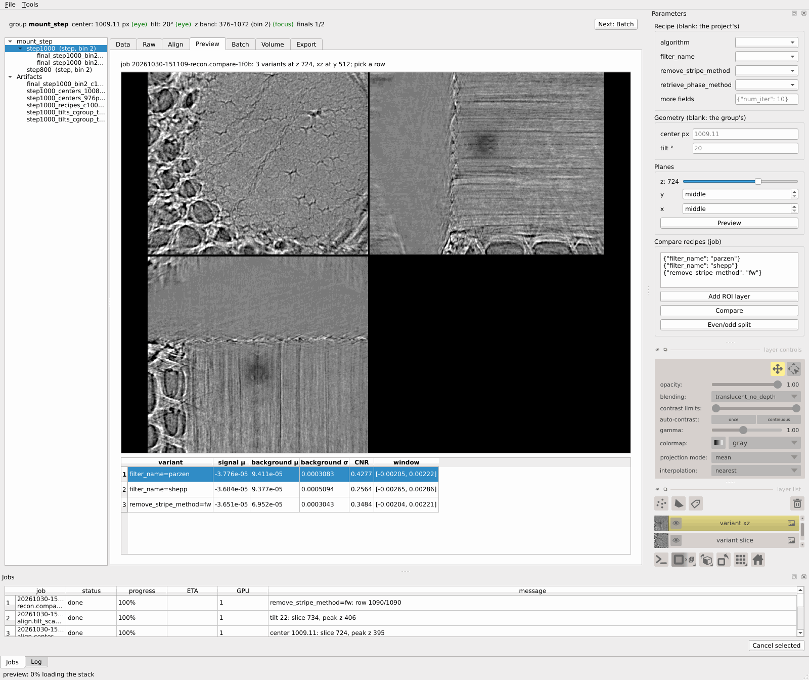

6. **Even/odd split**은 투영을 짝수·홀수 절반으로 나눠 각각 재구성하고(작업),
   두 slice와 FRC 곡선, 상관계수, FRC 해상도를 보여 준다
   (`halves 501/500, correlation 0.583, FRC resolution 14.6 px`).

   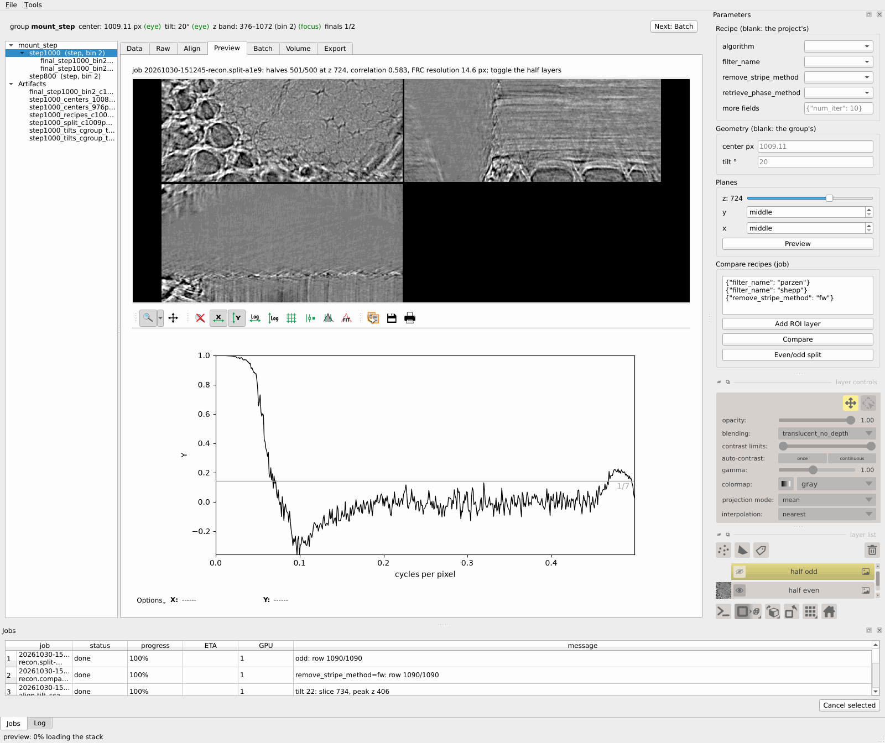

Compare/Split 결과(표, 변형 레이어)는 위 입력을 바꾸거나 **Preview**를 누를
때까지 남는다. 트리의 Artifacts에서 결과 파일(`<tag>_recipes_…`,
`<tag>_split_…`)을 누르면 다시 보인다.

## 5. Batch: 최종 volume 재구성

1. 위 머리글에 group과 적용될 레시피가 나온다. 표는 group의 scan마다 center px,
   tilt °, algorithm, filter, 출력 파일, 상태(`exists`, `to make`)다. 아래에
   batch GPU의 사용 여부가 나온다.

   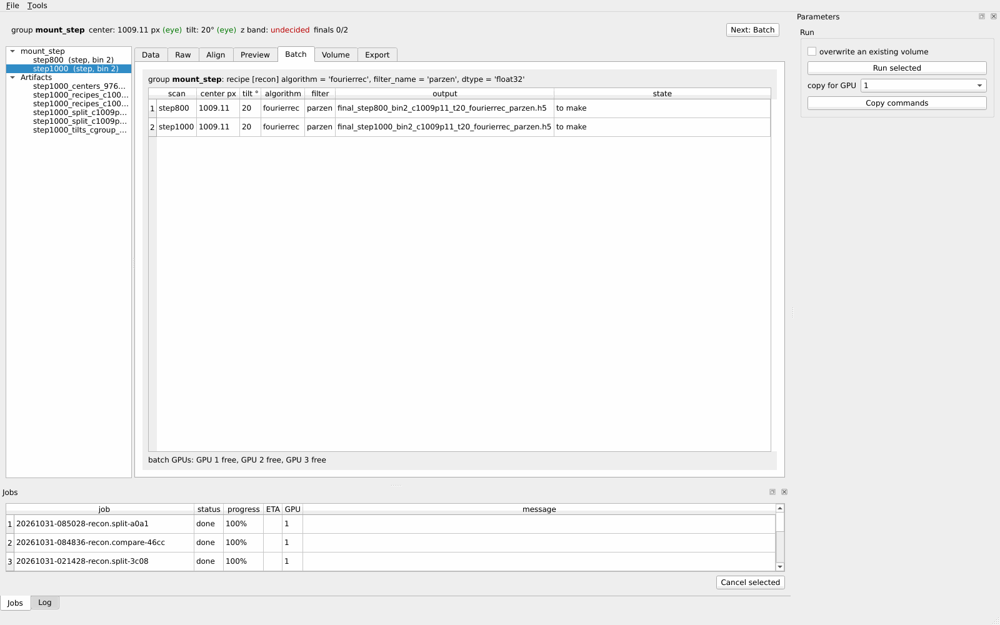

2. 만들 scan을 고르고 **Run selected**를 누르면 scan마다 빈 batch GPU에서
   작업이 하나씩 돈다. 이미 있는 volume을 다시 만들려면 **overwrite an
   existing volume**을 켠다. 실행 중인 행의 상태는 `running`이다.

   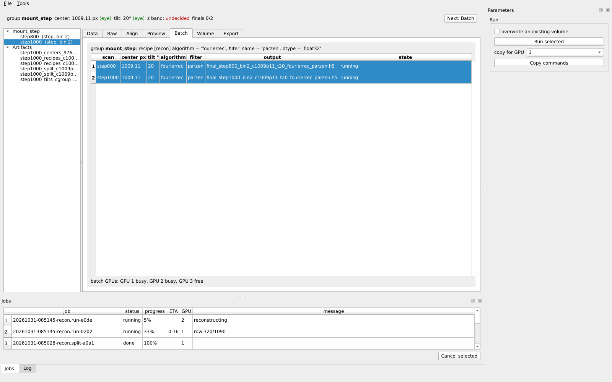

3. 끝나면 상태 줄이 `finals 2/2`, `Next: Export`가 된다.

   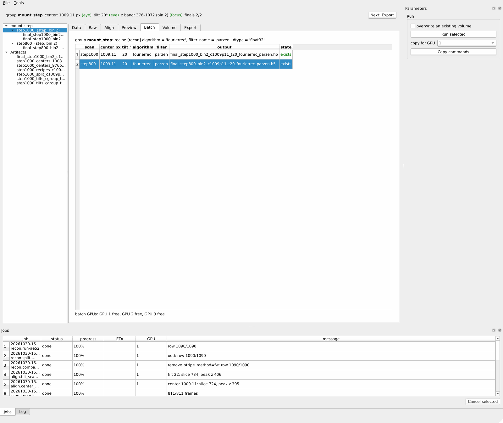

4. 다른 컴퓨터에서 돌리려면 **copy for GPU**를 고르고 **Copy commands**로 셸
   명령을 복사한다.

## 6. Volume: 결과 보기와 z band 결정

1. 트리에서 최종 volume을 누르면 Volume 탭에서 열린다. 머리글에 파일, 크기,
   dtype, tag, bin, center, tilt가 나온다. Slices 페이지에는 z slice, xz, yz
   단면이 있고, 노란 십자가 세 단면의 교차점이다. 초록 글은 시야(FOV) 분석이다
   (`every projection saw a disk of up to 504 px; its whole disk on slices
   184-906 (the cyan lines)`). 청록 선이 그 범위다.

   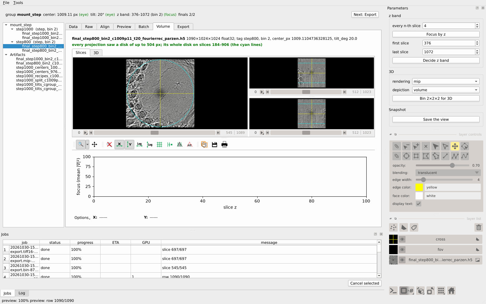

2. 한 단면을 더블클릭하면 십자가 그 점으로 옮겨지고 다른 두 단면이 따라간다.

   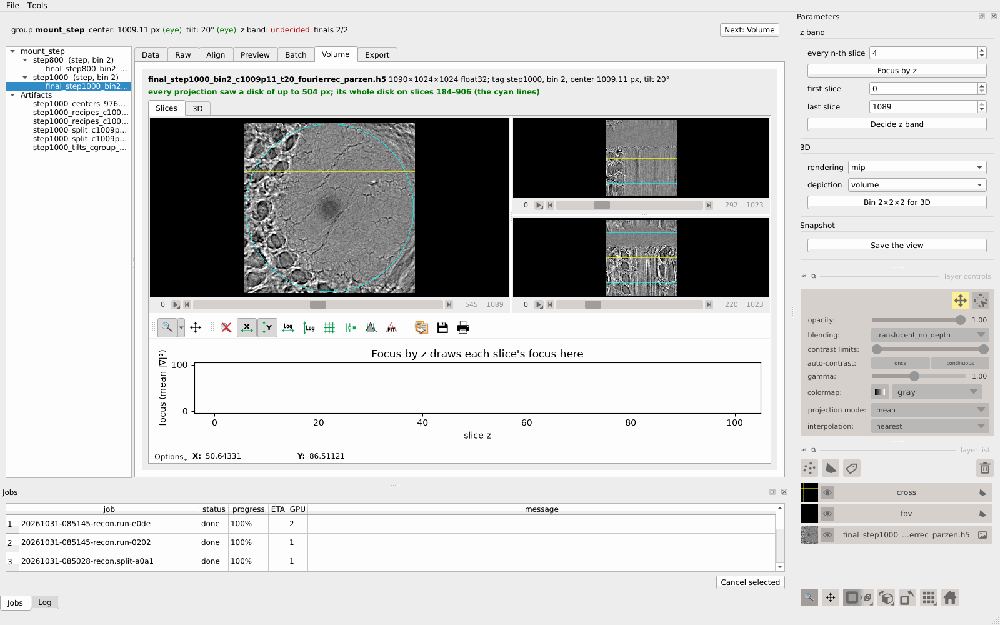

3. z band: **every n-th slice**를 정하고 **Focus by z**를 누르면 slice별 focus
   그래프가 나오고 **first slice**, **last slice**가 채워진다. 그래프의 회색
   선은 focus 봉우리(peak), 두 파란 선은 first/last slice이며 끌어서 옮길 수
   있다. 음영과 선의 뜻은 그래프 제목에 적힌다. 값을 확인하거나 고친 뒤
   **Decide z band**를 누르면 그 범위(양 끝 포함)가 group의 z band가 된다.

   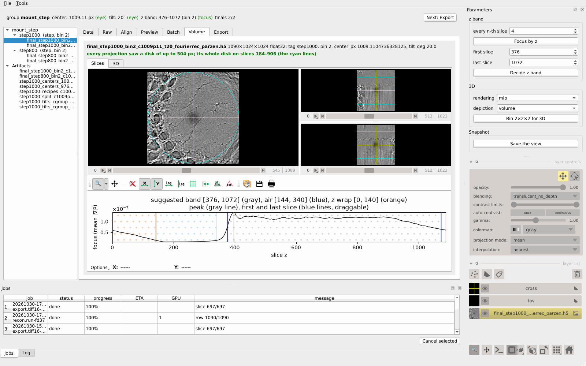

4. 3D: **Bin 2×2×2 for 3D**로 이 volume의 축소판을 만든다(작업). 끝나면 3D
   페이지에 `3D` 레이어가 생기고, **rendering**(mip 등)과 **depiction**
   (volume/plane)을 고른다. 3D 페이지에서는 layer controls/list가 3D 레이어의
   것으로 바뀌고, Slices로 돌아가면 다시 z slice의 것(cross, fov)이 된다.

   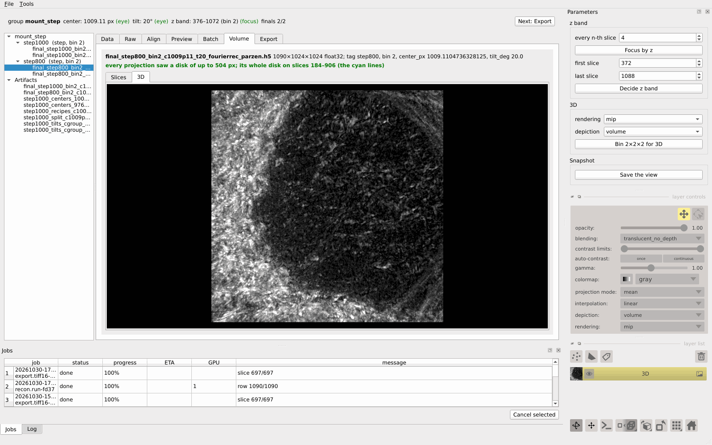

5. 끌어서 돌리고 휠로 확대한다. 기본 contrast에서는 MIP가 하얗게 포화된다.
   **Save the view**는 지금 보이는 화면을 `artifacts/figures` 아래 PNG로 저장한다.

   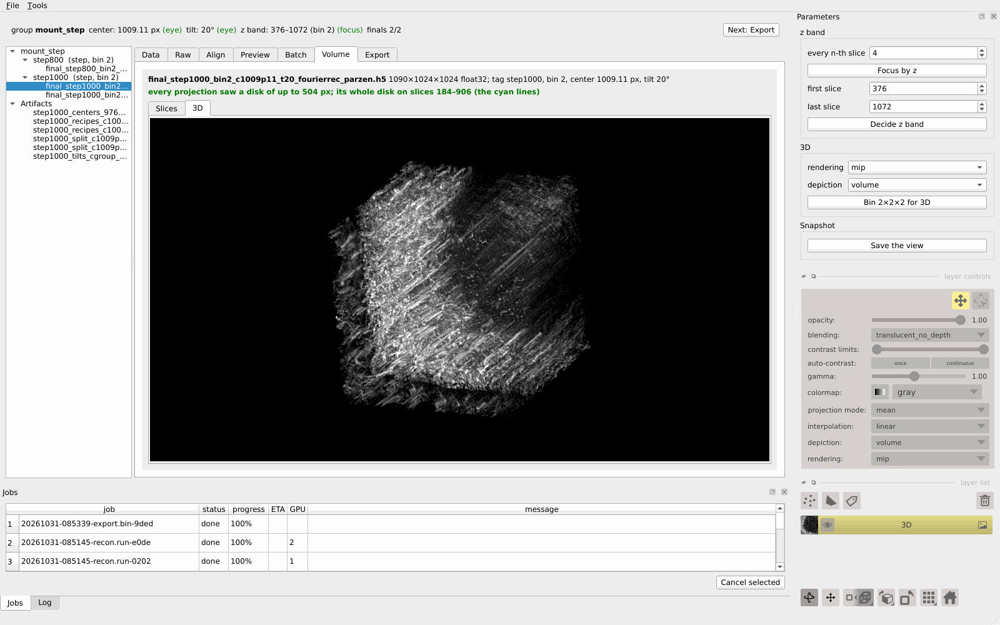

## 7. Export: 내보내기

1. **Slices [z0, z1)**에는 group의 z band가 채워진다(z band 376–1072 →
   z0 376, z1 1073; z1은 포함하지 않음).

   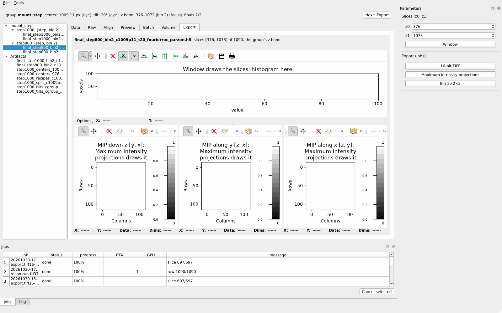

2. **Window**는 히스토그램과 TIFF가 0–65535로 옮겨질 창(p0.1–p99.9)을 계산한다.

   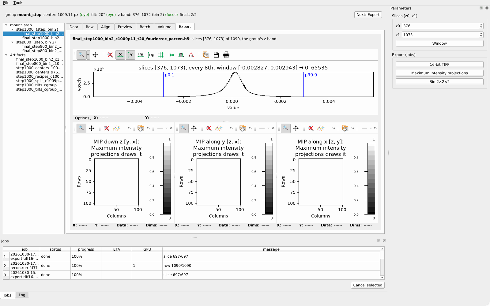

3. **Maximum intensity projections**는 z, y, x 방향 MIP를 만든다(작업).
   결과는 `artifacts/<stem>_z<z0>-<z1>_mip.h5`다.

   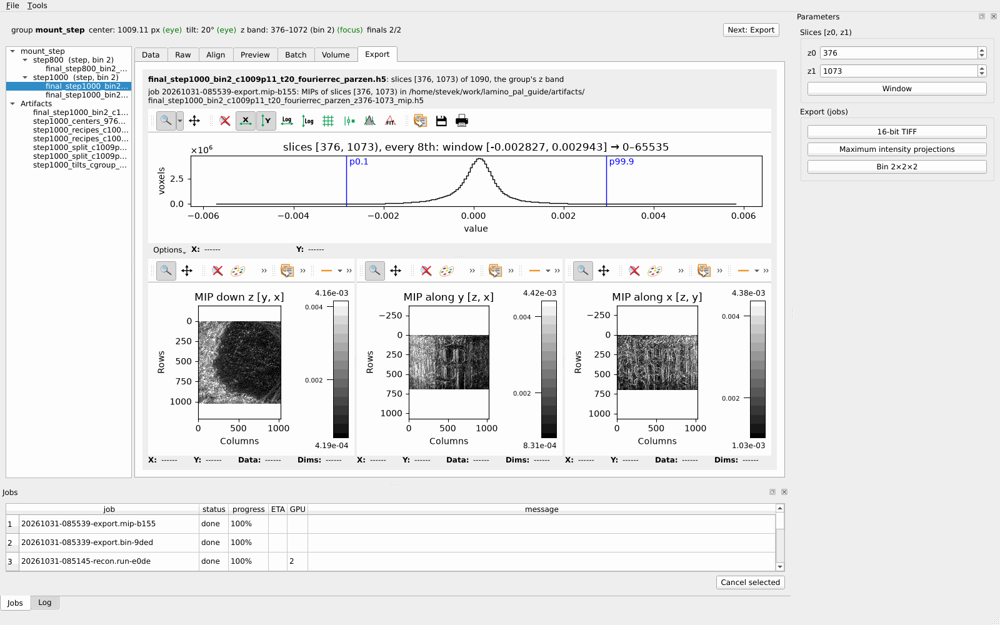

4. **16-bit TIFF**는 그 범위를 window로 16-bit BigTIFF
   `<stem>_z<z0>-<z1>_16bit.tif`에 쓴다(작업). 끝나면 머리글에 파일, slice 수,
   window가 나온다.

   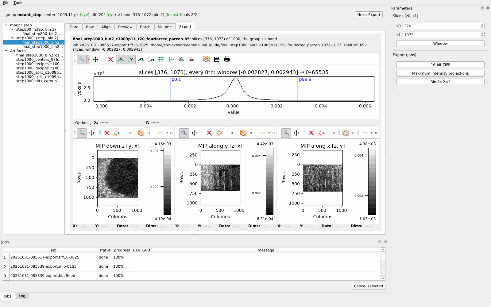

5. **Bin 2×2×2**는 volume 전체를 축소해 `<stem>_binned.h5`로 쓴다(3D 보기용).
