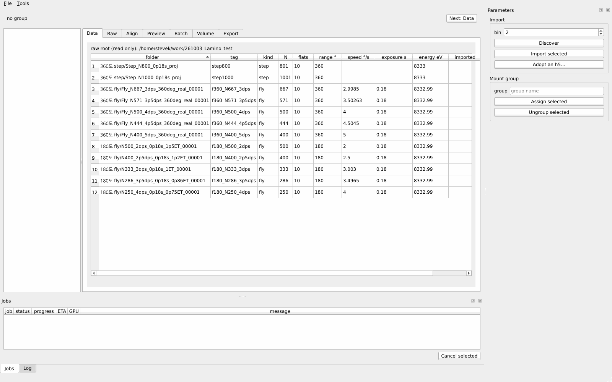

# Lamino-Pal GUI 사용 설명서

스캔 폴더 가져오기부터 16-bit TIFF 내보내기까지, 한 mount group을 GUI로
처리하는 순서다. 캡처는 빈 프로젝트 `~/work/lamino_pal_guide`(raw root
`~/work/261003_Lamino_test`)에서 시작해 `step800`, `step1000`을 가져오고 group
`mount_step`으로 묶어 끝까지 진행하며 찍었다.

```
lamino-pal-gui --project ~/work/lamino_pal_guide/project.toml
```

`--project`의 `project.toml`이 없으면 raw root를 물은 뒤 새로 만든다.
`--project` 없이 띄우면 **Open…**(기존 `project.toml`)과 **Create…**(작업
폴더와 raw root를 고름) 중 하나를 묻는다. 띄운 뒤에는 File ▸ Open
project…로 바꾼다. GUI는 그 프로젝트의 GPU에 묶여 다시 실행된다.

## 0. 화면 구성


- **왼쪽 트리**: group ▸ scan(`step1000 (step, bin 2)`) ▸ 그 scan에서 만든
  프로젝트 폴더의 volume(최종 volume, 3D용 축소판 `_binned.h5`), 그리고
  `Artifacts`(정렬·비교 결과 파일). 항목을 누르면 그 대상이 현재 문맥(context)이 된다. volume은 Volume
  탭에서, artifact는 그 파일을 만든 작업의 탭에서 열린다.
- **상태 줄**(위): 현재 group과 결정값 `center`, `tilt`, `z band`. 괄호는 그
  값을 정한 방법이다. `(rings)`·`(sweep)`·`(eye)`·`(focus)`·`(user)`는 사람이 정한
  것(초록), `(agent)`는 agent가 고른 것(주황), `undecided`는 미정(빨강)이다.
  agent가 고른 값이 있으면 **Confirm agent decisions** 버튼이 나타난다.
  `finals n/m`은 group의 scan 중 최종 volume이 있는 수이고, **Next: …** 버튼은
  다음에 할 탭으로 이동한다(center·tilt 미정이면 Align, 최종 volume이 없으면
  Batch, z band 미정이면 Volume, 다 되면 Export).
- **탭**: Data → Raw → Align → Preview → Batch → Volume → Export 순서로
  진행한다.
- **오른쪽 Parameters**: 현재 탭의 입력과 버튼. 이미지 viewer가 있는 탭에서는
  그 아래에 napari의 **layer controls**(선택한 레이어의 도구·contrast·색)와
  **layer list**(레이어 목록, 눈 아이콘으로 표시/숨김, 휴지통 버튼으로 삭제, 맨
  아래 줄 오른쪽 집 아이콘이 Reset view)가 붙는다. layer list와 그 버튼들은 지금
  보이는 탭의 viewer에 작용한다. 이 오른쪽 열은 창 높이 전체를 쓰고, 각 칸은
  내용만큼 높이를 받으며 남는 높이는 layer list가 갖는다. 창이 낮아 모자라면
  칸 안에서 스크롤된다(Align, Preview의 Parameters는 1600×1000 창에서 아래 버튼이
  가려져 스크롤해야 보인다). 창을 탭 내용보다 작게 줄이면 탭도 스크롤된다.
- **layer controls**는 영상 레이어의 것이 기본이다. 윤곽선·십자·몽타주 테두리
  같은 덧그림 레이어가 생겨도 선택은 영상에 남는다. ROI처럼 직접 그리는
  레이어는 그것을 만든 버튼이 골라 준다.
- **그래프**: 결과가 없는 그래프는 제목에 그것을 채우는 버튼을 적는다(예:
  `Focus by z draws each slice's focus here`). 선과 음영의 뜻도 제목에 색 이름으로
  적힌다. 곡선의 끝과 봉우리는 테두리에서 떨어지게 축 범위가 잡힌다. 실패
  메시지는 제목에 줄바꿈되어 다 나오고, 그만큼 그래프가 높아진다.
- **이미지 viewer의 마우스**는 silx 그래프와 같다. layer list 아래 버튼 줄 맨
  왼쪽의 두 버튼이 silx 툴바의 Zoom 모드와 Pan 모드다. Zoom 모드(2D 기본)에서는
  왼쪽으로 끌어 그린 사각형으로 확대하고, 오른쪽 클릭 메뉴의 **Zoom Back**으로
  그 전 화면(더 없으면 전체 맞춤)으로 돌아간다. 영상이 바뀌면(새 결과, 다른
  volume) Zoom Back 기록은 지워진다. Pan 모드에서는 왼쪽으로 끌어 옮긴다. 두
  모드 모두 가운데 버튼으로 끌면 옮기고, 휠은 커서를 중심으로 확대·축소한다.
  사각형을 그리는 레이어(ROI)가 선택돼 있으면 왼쪽 끌기는 그 레이어가 쓴다.
  3D는 6절 5번에 있다.
- **아래 Jobs / Log**: 탭 아래에 있다. GPU 작업의 상태·진행률·남은 시간·GPU와
  진행 메시지. 끝난(`done`) 작업의 메시지 칸은 비고, 결과는 그 작업의 탭에
  나온다. 실패하거나 취소된 작업은 멈춘 곳의 메시지를 남긴다. 작업을 고르고
  **Cancel selected**로 취소한다. Log 탭은 실행한 op의 기록이다.
- **창 맨 아래 상태 막대**: 안내와 거절·오류는 20초, 작업 접수(`job … queued`)는
  10초, 작업 진행률은 5초 동안 나왔다가 지워진다.
- **Tools ▸ Run op…**: 아무 op나 고르고(`탭 · op 이름 [cost, GPU]`) 입력을 채워
  **Run**으로 실행한다. 입력은 현재 문맥으로 미리 채워진다. 작업 op는 Jobs에
  올라가고, 나머지는 바로 돌아 결과 JSON과(그 op에 그림이 있으면) 그림을 보여 준다.

## 1. Data: 스캔 가져오기와 group 지정

1. Data 탭을 처음 열면 raw root(읽기 전용) 아래의 스캔 폴더를 자동으로
   찾는다(**Discover**와 같다). 표에는 폴더, tag, 종류(step/fly), 투영 수 N,
   flat 수, 회전 범위, 속도, 노출, 에너지, 이미 가져온 tag(`imported`), 그 scan의
   group이 나온다(오른쪽 칸은 가로 스크롤).

   

2. 가져올 폴더 행을 고른다(Ctrl/Shift로 여러 개). tag 칸은 더블클릭해 고칠
   수 있다. **bin**(기본 2)을 정하고 **Import selected**를 누르면 폴더마다
   `scan.import` 작업이 하나씩 돈다. Jobs에 `811/811 frames`처럼 진행이
   나오고, 끝나면 `imported` 칸에 tag가 들어가며 트리의 `(no group)` 아래에
   scan이 생긴다.

   

3. 가져온 행을 고르고 Mount group의 **group** 칸에 이름(`mount_step`)을 쓴 뒤
   **Assign selected**를 누른다. 표의 `group` 칸이 채워지고, 트리에서 scan이 그
   group 아래로 들어가며, 상태 줄에 그 group(`finals 0/2`, `Next: Align`)이
   나온다. 트리에서 group을 누르면 상태 줄이 그 group의 것으로 바뀐다.
   **Ungroup selected**는 group에서 뺀다. 이미 만든 h5는 **Adopt an h5…**로
   들인다.

   

## 2. Raw: 원본 투영 확인

1. 트리에서 scan을 고르고 Raw 탭으로 간다. 슬라이더로 투영을 넘기며, 위
   글줄에 투영 번호와 각도, 그리고 한 바퀴의 투영 수·각도 범위·간격과
   "first + 360°"에 해당하는 투영 번호가 나온다(`full turn: 1001 projections,
   0.00° to 360.00°, step 0.3600° (±0.0600), first + 360° at 1000`).

   

2. **Mean**(every n-th)은 n장마다의 평균 투영을 만든다.
3. **Drift**는 360° 뒤의 투영을 첫 투영과 비교한다. 첫 투영은 초록(`first`),
   360° 뒤 투영은 자홍(`turn`)으로 겹쳐지고, 버튼 아래에 어긋남이 나온다
   (`projection 1000 against 0: dy +0.4 px, dx -12.8 px (full resolution)`).

   

4. **Tilt flow**는 optical flow로 tilt를 어림한다. tilt scan의 교차 확인용이고
   결정값이 되지 않는다.

## 3. Align: 회전 중심과 tilt 결정

### 3.1 Rings

**every n-th**(10)와 **row bands**(4)를 정하고 **Rings**를 누른다. 투영의
링에서 중심을 어림해 `center 992.11 px, prominence 3.1; bands 987.4, 991.5,
989.3, 996.8 (spread 9.4 px)`처럼 보여 준다. prominence가 8 미만이면 주황
글씨다(믿기 어려움). 이 값을 쓰려면 **Decide center (rings)**를 누른다. viewer는
평균 투영 위에 전체 중심(노랑)과 band별 중심(청록) 선을 그린다.


### 3.2 Center sweep

1. **center px**(비우면 group 값, 없으면 rings 값), **± px**, **step px**,
   **tilt °**(비우면 group 값, 없으면 20), **slice**(비우면 z band 가운데)를
   정하고 **Sweep**을 누른다. 위 글줄에 판정과 실제로 쓴 값이 나온다.
   `resolved`(초록)는 봉우리가 하나로 분명한 것, `ambiguous`(주황)는 경쟁
   후보가 가까운 것, `railed`(주황)는 봉우리가 범위 끝에 걸린 것이다. 예:
   `ambiguous: center 1009.11 px on slice 545 at tilt 20° (center from rings);
   rivals 976.11 (−5.2%): compare them by eye`. `railed`이면 **Widen range**
   버튼이 나타나 그 봉우리를 중심으로 두 배 범위로 다시 sweep한다.
2. viewer에는 후보 중심마다의 slice가 쌓이고, 왼쪽 위에 그 후보의 중심값과
   `(best)`·`(rival)`이 붙는다. 아래 그래프에는 중심별 focus 값과 best(초록 선),
   경쟁 후보(주황 선)가 나온다.

   

3. 후보는 슬라이더, 그래프 클릭 중 하나로 고른다. 고른 후보는 그래프에 파란
   선(picked)으로 나온다.

   

4. **Compare by eye**는 best와 그 경쟁 후보, 고른 후보를 각각 전체로 재구성해
   band 가운데 slice를 타일로 나란히 보여 준다(작업). 각 타일 안에 중심값이
   붙고, 아래 그래프는 중심별 focus다. 타일이나 그래프를 눌러 고르면 그 타일에
   파란 테두리가 생긴다.

   

5. 고른 후보로 **Decide selected center**를 누르면 상태 줄의 center가 바뀐다.
   `resolved` sweep의 best를 그대로 정하면 `(sweep)`, 그 밖에는 `(eye)`가 붙는다.

### 3.3 Tilt

**tilts °**에 후보를 공백으로 쓰고(`16 18 20 22 24`) **Tilt scan**을 누른다(작업).
위 줄은 tilt별 band 가운데 slice, 아래 줄은 같은 tilt의 xz 단면이며 각 타일에
tilt가 붙는다. 아래 그래프의 tilt별 focus는 회색의 참고값이다. 그 추세는
실행마다 달라 tilt를 정할 근거가 되지 않으므로(그래프 제목에 적혀 있다) 타일을
눈으로 비교한다. 타일이나 그래프를 눌러 고르면 그 타일에 파란 테두리가 생긴다.
**Decide selected tilt**를 누른다.


## 4. Preview: 레시피 확인과 품질 비교

1. Preview 탭을 열면 현재 문맥으로 미리보기가 돈다(지난번 뒤 입력이 바뀌었을
   때만). 위 글줄에 쓴 중심·tilt·단면 위치·volume 깊이·레시피가 나오고
   (`center 1009.11 px, tilt 20°, z 545 y 512 x 512 of depth 1090;
   algorithm=fourierrec, filter_name=parzen, …`), z·y·x 세 단면이 격자로 나온다.

   

2. Parameters에서 **Recipe**(비우면 프로젝트 레시피: algorithm, filter_name,
   remove_stripe_method, retrieve_phase_method, more fields에 JSON),
   **Geometry**(비우면 group의 center px, tilt °), **Planes**(z 슬라이더, y,
   x)를 바꾸면 다시 계산한다. **Preview**는 입력이 같아도 다시 계산한다.
3. CNR을 재려면 **Add ROI layer**를 누른다. `ROI` 레이어가 사각형 그리기
   상태로 골라지고, 아래 상태 막대에 "draw the signal rectangle first, the
   background second"가 나온다. z 단면 위에 신호 영역을 먼저, 배경 영역을
   그다음에 끌어 그린다. ROI가 없으면 비교는 돌지만 CNR 칸이 빈다.

   

4. **Compare recipes** 칸에 레시피 변형을 한 줄에 JSON 객체 하나씩 쓴다
   (비우면 기본값들). 예:

   ```
   {"filter_name": "parzen"}
   {"filter_name": "shepp"}
   {"remove_stripe_method": "fw"}
   ```

   **Compare**를 누르면 작업으로 돈다. Jobs에 `filter_name=parzen: row
   1090/1090`처럼 변형별 진행이 나온다.

   

5. 끝나면 위 글줄이 `3 variants at z 545, xz at y 512; pick a row`가 되고, 표에
   variant, signal μ, background μ, background σ, CNR(= |μs − μb| / σb), window가
   나온다. 행을 고르면 그 변형의 z slice와 xz 단면이 그 변형의 window로 보인다.
   이 예에서는 parzen 0.1758, shepp 0.09929, fw 0.06258이다.

   

6. **Even/odd split**(Compare 아래, Parameters를 스크롤)은 투영을 짝수·홀수
   절반으로 나눠 각각 재구성하고(작업), 위 글줄에 두 절반의 투영 수, 상관계수,
   FRC 해상도를 보여 준다(`halves 501/500 at z 545, correlation 0.729, FRC
   resolution 13.8 px`). 아래 그래프는 FRC 곡선과 회색 1/7 기준선이다. 두 절반은
   `half even`, `half odd` 레이어이며(처음엔 even만 보임) layer list의 눈
   아이콘으로 바꿔 본다.

   

Compare/Split 결과(표, 변형 레이어)는 위 입력을 바꾸거나 **Preview**를 누를
때까지 남는다. 트리의 Artifacts에서 결과 파일을 누르면 다시 보인다. 결과
파일(`<tag>_recipes_c<center>_t<tilt>_<hex>.h5`, `<tag>_split_…`, Align의
`<tag>_centers_…`, `<tag>_tilts_…`) 이름 끝의 6자리 hex는 입력 전체의
digest라서, ROI·z·후보를 바꿔 다시 돌리면 앞 결과를 덮지 않고 새 파일이 된다.
입력이 같고 그 작업 뒤 프로젝트와 데이터가 바뀌지 않았으면 다시 돌리지 않고 그
작업의 결과를 보여 준다. 그 사이 프로젝트가 바뀌었으면(예: 값을 Decide함) 같은
입력은 `… exists; pass overwrite to replace it`으로 거절되고, GUI에는 이 결과
파일을 덮어쓰는 옵션이 없다.

## 5. Batch: 최종 volume 재구성

1. 위 머리글에 group과 적용될 레시피가 나온다(`group mount_step: recipe [recon]
   algorithm = 'fourierrec', filter_name = 'parzen', dtype = 'float32'`). 표는
   group의 scan마다 center px, tilt °, algorithm, filter, 출력 파일, 상태(`exists`,
   `to make`)다. 아래에 batch GPU의 사용 여부가 나온다.

   

2. 만들 scan을 고르고 **Run selected**를 누르면 scan마다 빈 batch GPU에서
   작업이 하나씩 돈다. 이미 있는 volume을 다시 만들려면 **overwrite an
   existing volume**을 켠다. 실행 중인 행의 상태는 `running`이고 아래 줄에 쓰는
   GPU가 `busy`로 나온다.

   

3. 끝나면 상태가 `exists`, 상태 줄이 `finals 2/2`가 된다. z band가 아직
   미정이므로 다음은 `Next: Volume`이다.

   

4. 다른 컴퓨터에서 돌리려면 **copy for GPU**를 고르고 **Copy commands**로 셸
   명령을 복사한다.

## 6. Volume: 결과 보기와 z band 결정

1. 트리에서 최종 volume을 누르면 Volume 탭에서 열린다. 머리글에 파일, 크기,
   dtype, tag, bin, center, tilt가 나온다(`1090×1024×1024 float32; tag step1000,
   bin 2, center 1009.11 px, tilt 20°`). Slices 페이지에는 z slice, xz, yz 단면과
   그 아래 focus 그래프가 있고, 노란 십자가 세 단면의 교차점이다. 초록 글은
   시야(FOV) 분석이다(`every projection saw a disk of up to 504 px; its whole
   disk on slices 184-906 (the cyan lines)`). 청록 원과 선이 그 범위다. z band가
   미정이면 first/last slice는 volume 전체(0–1089)다.

   Windows에서는 volume을 열 때 파일 전체를 메모리로 읽는다(4.3 GiB에 수 초).
   Windows는 프로세스가 열거나 매핑한 파일을 교체하지 못하므로, 보는 동안에도
   job이 그 파일을 덮어쓸 수 있게 파일을 잡아 두지 않는 것이다. 그래서 거기서는
   메모리에 들어가는 volume만 열 수 있다.

   

2. 한 단면을 더블클릭하면 십자가 그 점으로 옮겨지고 다른 두 단면이 따라간다.

   

3. z band: **every n-th slice**를 정하고 **Focus by z**를 누르면 slice별 focus
   그래프가 나오고 **first slice**, **last slice**가 제안 band로 채워진다(이
   예에서는 376, 1072). 그래프의 음영은 제안 band(회색), 시료 밖 공기(파랑),
   z wrap(주황)이고, 회색 선은 focus 봉우리(peak), 두 파란 선은 first/last
   slice이며 끌어서 옮길 수 있다. 값을 확인하거나 고친 뒤 **Decide z band**를
   누르면 그 범위(양 끝 포함)가 group의 z band가 되어 상태 줄이 `z band:
   376–1072 (bin 2) (focus)`, `Next: Export`가 된다.

   

4. 3D: **Bin 2×2×2 for 3D**로 이 volume의 축소판 `<stem>_binned.h5`를
   만든다(작업). 끝나면 3D 페이지에 `3D` 레이어가 생기고, **rendering**(mip 등)과
   **depiction**(volume/plane)을 고른다. contrast는 rendering이 z 방향으로 그리는
   상(mip은 최댓값 투영)의 0.5–99.5% 구간이고, rendering을 바꾸면 다시 정해진다.
   3D 페이지에서는 layer controls/list가 3D 레이어의 것으로 바뀌고, Slices로
   돌아가면 다시 z slice의 것(controls는 영상의 것, list는 영상과 덧그림 cross,
   fov)이 된다.

   

5. 3D에서는 첫 버튼이 Rotate 모드가 된다. 왼쪽으로 끌어서 돌리고, Pan 모드나
   가운데 버튼, Ctrl+왼쪽으로 끌어서 옮기고, 휠로 커서 아래 점을 향해 확대한다.
   **Save the view**는 지금 보이는 화면을 `artifacts/figures` 아래 PNG로 저장한다.

   

## 7. Export: 내보내기

1. **Slices [z0, z1)**에는 group의 z band가 채워진다(z band 376–1072 →
   z0 376, z1 1073; z1은 포함하지 않음). 그래프는 각 버튼이 채운다.

   

2. **Window**는 그 범위를 8 slice마다 읽어 히스토그램과, TIFF가 0–65535로
   옮겨질 창(p0.1–p99.9, 파란 선)을 계산한다(`slices [376, 1073), every 8th:
   window [-0.002827, 0.002943] → 0–65535`).

   

3. **Maximum intensity projections**는 z, y, x 방향 MIP를 만든다(작업).
   결과는 `artifacts/<stem>_z<z0>-<z1>_mip.h5`다. y, x 방향 MIP의 행은 z0부터
   센 slice다.

   

4. **16-bit TIFF**는 그 범위를 window로 16-bit BigTIFF
   `<stem>_z<z0>-<z1>_16bit.tif`(프로젝트 폴더)에 쓴다(작업). 끝나면 volume을 적은
   머리글 아래 줄에 작업, 파일, slice 수, window가 나온다(`…_z376-1073_16bit.tif,
   697 slices, window [-0.002827, 0.002943]`). MIP와 Bin도 같은 줄에 나온다.

   

5. **Bin 2×2×2**는 volume 전체를 축소해 `<stem>_binned.h5`로 쓴다(3D 보기용).
